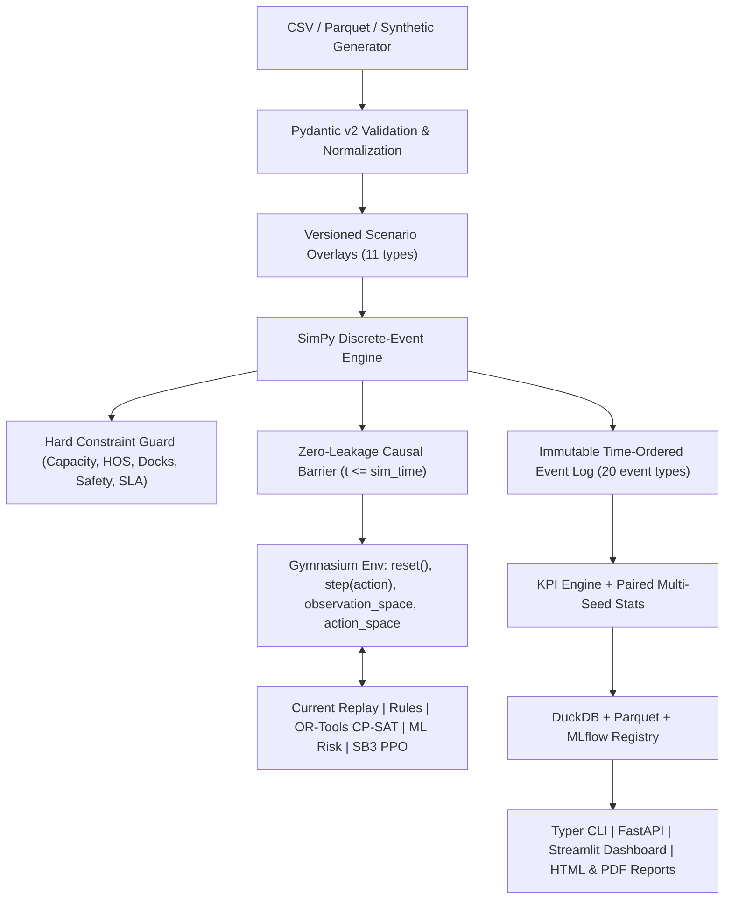

# Architecture — Logistics Backtester (Reverse Logistics MVP)

## Decision Domain (v1)

**E-commerce Reverse Pickup Dispatching & Hub Triage**

At hourly decision epochs across a multi-day horizon, policies assign pending customer return orders (`Order`) to return pickup vehicles (`Vehicle` + `Driver`) or an overflow 3PL carrier. Dispatched vehicles execute multi-stop pickup routes in SimPy, arrive at return hubs (`Location`), claim dock bays (`simpy.Resource`), unload quarantine inventory (`InventoryPosition`), undergo human grading (`Picker` inspection bays), and are routed by sortation bots (`Robot`) into `restock`, `refurbish`, `liquidate`, or `recycle` outcomes.

## System Architecture

## Leakage Prevention & Cryptographic Provenance

- Policies only receive `DecisionContext` and flat `observation` vectors generated strictly at `t <= env.now`.
- Every `PolicyDecision` logs a SHA-256 `observation_hash` over the causal `DecisionContext` used at that step.
- Ground-truth `true_disposition` and `cancel_minute` exist only on internal `OrderRuntimeRecord` inside the simulator and are excluded from `PublicOrderView`.
- Dynamic scenario disruptions (`vehicle_breakdown`, `weather_disruption`, `carrier_delay`, `labor_absence`, `warehouse_capacity_reduction`, `sku_availability_shock`) activate inside SimPy at `start_minute` and are never exposed prior to `DISRUPTION_STARTED`.
- Data ingestion enforces strict CSV string ID preservation, duplicate-header rejection, mixed-provenance rejection, and atomic content-addressed snapshots (`SnapshotManifest` + `orders.parquet` + `orders.jsonl`). See [data-contract.md](data-contract.md) and [schema.sql](schema.sql).

## Hard Constraint Enforcement

`ConstraintGuard` validates every action batch before SimPy process spawning:
- Vehicle weight (`kg`), volume (`m3`), and unit capacities
- Hazmat/battery safety segregation (`hazmat_certified` vehicle check)
- Driver Hours-of-Service (`max_shift_minutes`) and shift calendar working hours
- Hub storage limits and SimPy `Resource` dock/inspection concurrency
- Attempted violations are blocked, logged as `exception_raised`, counted in `constraint_violations`, and heavily penalized in RL reward.
